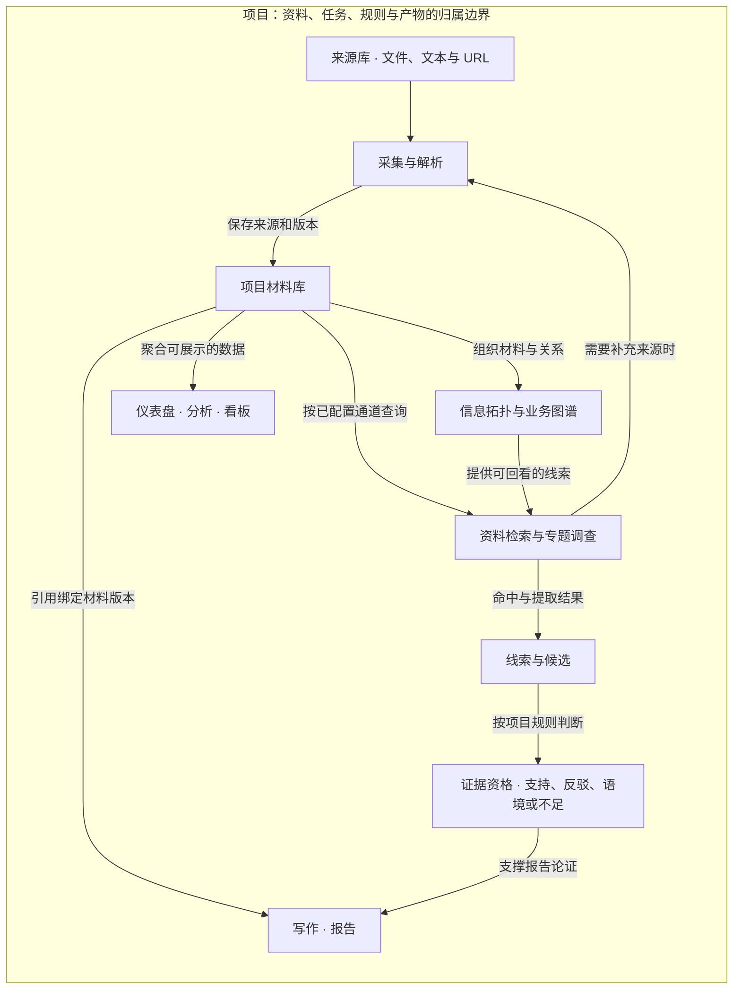
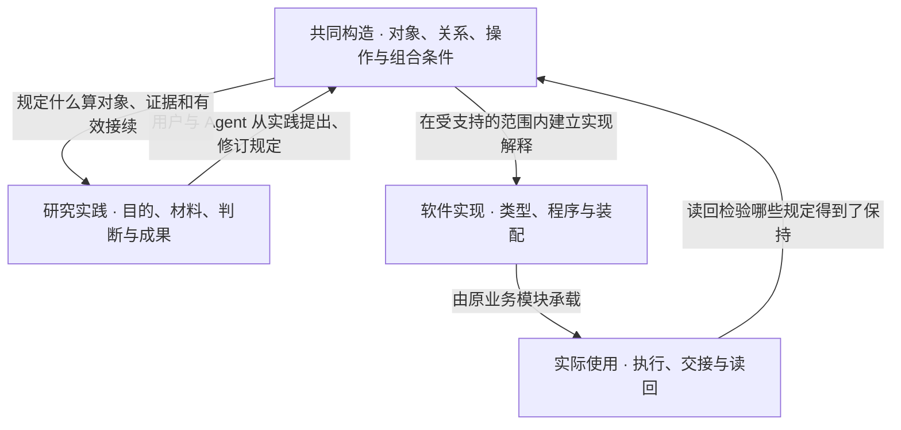
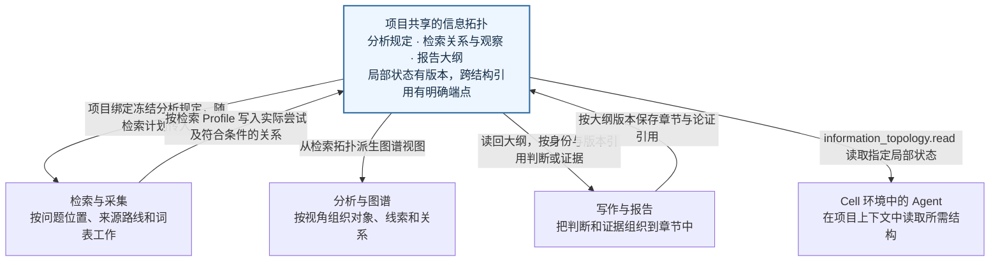
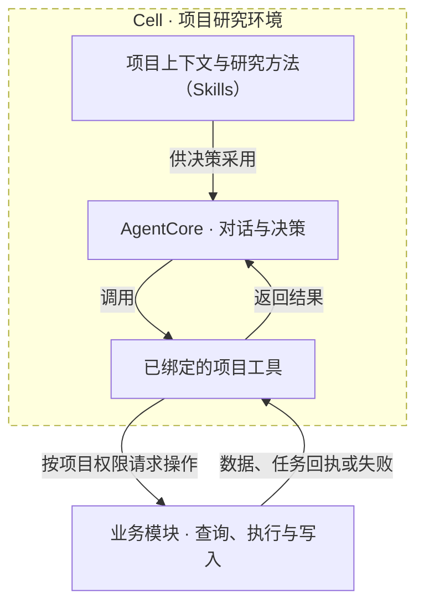

# 市场研究工作流（MRW）

MRW 是一个**单用户市场研究工作台**。它把分散的来源、调查线索和写作放进同一个项目，让报告能追溯到形成判断时实际使用的材料。你可以从已有资料开始分析，也可以从一个问题开始采集；写到证据不足的地方，还可以沿着缺口回到检索，而不必重新做一遍调查。

[本机部署](#本机部署) · [在项目里做研究](#在项目里做研究) · [系统架构与关键设计](#系统架构与关键设计) · [界面与文档导航](#界面与文档导航)

## 在项目里做研究

研究从一个[项目](http://127.0.0.1:15132/#/admin/projects)开始。项目确定资料、任务、会话和报告归属；切换工作台窗口不会改变已绑定线程或在途任务的项目。共享原文可以被多个项目引用，各项目对它作出的判断仍分别保存。归档会阻止新的业务写入，但不会删除资料，也不等于取消已经接纳的任务。

已有文件、文本和网址可直接导入；需要补充材料时，可从[资源库](http://127.0.0.1:15132/#/admin/resources)选择来源，按相应通道[发起采集](http://127.0.0.1:15132/#/workbench/ingest)。后台负责解析、去重、入库，并为适用材料更新索引。材料入库和进入搜索索引是两件事：在[资料与质量](http://127.0.0.1:15132/#/admin/ops)可以分别查看项目库和索引检索结果。专题检索还可以先预览方法，再查看实际使用了哪些通道、得到了哪些材料；通道不可用，不等于查过之后没有命中。

找到材料后，可以在[仪表盘](http://127.0.0.1:15132/#/visual/dashboard)、[业务图谱](#业务图谱导航)和[专题看板](http://127.0.0.1:15132/#/visual/board)中比较数据、顺着关系找线索。搜索命中和提取候选只是判断的输入；采纳为正式知识要满足项目规则，并保留依据。进入[写作工作台](http://127.0.0.1:15132/#/workbench/writing)后，引用卡指向当时使用的材料版本。可以先用信息卡和大纲整理草稿，正式报告则按模板检查证据，并支持 Markdown 导出。资料本身缺失和取源失败会分别记录，方便决定下一步是补证还是重试。

这张图画的是能力之间的关系，不是规定每次研究都要经过的步骤。需要 Agent 参与时，可以从同一项目打开[Agent 工作台](http://127.0.0.1:15132/#/workbench/agent)：它可以协助读材料、组织线索或发起已定义的工作流；后台任务的进度、失败和结果仍到[运行记录](http://127.0.0.1:15132/#/admin/process)查看。

## 系统架构与关键设计

在 MRW 中，用户和 Agent 用来讨论研究的概念，也是开发者用来构造程序的概念。函子化架构关注的是，研究中有意义的操作怎样成为可以组合的软件能力。项目持续维护一份信息拓扑，让这些操作在不同环节仍能接着处理同一个问题、同一项判断；Cell 是 Agent 与系统之间的中介：它让这份拓扑在对话中可读，让相应的领域操作成为 Agent 在项目内可用的工具。

### 函子化架构：研究活动与软件构造

**概念、建模和程序是同一项设计的三种表达。** 用户与 Agent 用工作语言辨明「什么算作证据」；在模型里，证据不再只是材料的一个标签，而是材料对特定判断所起的作用，有对象、方向和适用条件；在程序里，检索可以交出候选，报告可以引用特定版本的判断或证据，但一次命中本身不能让候选取得证据资格。这不是从需求文档逐级翻译到代码的单行道。如果从报告引用找不回当时的判断，缺的可能不是一个页面链接，而是模型尚未区分「同一个判断」和「这个判断的某个版本」。实际使用也参与修订概念。

**函数式编程提供了组织工作的方式，范畴论说明这种组织在实现中要保持什么。** 从函数式编程看，一个研究操作可以写成有明确输入和输出的程序值；输入输出相接的小程序可以组成较大的程序，而描述一次采集并不等于已经访问了来源。从范畴论看，可交接的对象及其间的操作构成建模的起点：对象在实现中由类型和数据承载，操作由程序承载。称这样的解释为「函子」，要求它保持恒等与复合：原样交接仍是原样交接；先在领域中组合两个操作再解释，应当与先分别解释、再按原序组合有相同的交接含义。仅仅让两个接口的数据格式对得上，并不足以满足这个要求。

[运行时设计](docs/architecture/runtime/contract.md)给出了一个具体的保持要求：`Compile` 将类型化研究程序解释为执行计划，既要保留 `Then` 的组合次序，也要保留下游依赖的结果、失败与权限条件。真正的读取、采集或写入仍由相应的业务执行者完成。在开发侧，[原生贡献目录](contributions/project_catalog.py)汇集领域定义，[运行操作装配](main/backend/app/composition/installed_operation.py)从同一操作定义派生目录视图和执行绑定。这样，能够机械确定的接线不用再写一套，什么构成证据之类的领域判断也不会被交给编译器猜测。

程序可以组合，研究却不需要按预定顺序展开。要让一次补查能够接上已经写到一半的论证，项目必须记得它们围绕的是哪个问题、哪项判断，以及两者之间还缺什么依据。这正是信息拓扑在函子化架构中的用途。

### 信息拓扑：用同一份结构贯穿研究工作

MRW 以项目为单位维护一份**信息拓扑**。它记录研究对象之间有哪些关系、材料在哪个问题下起作用，以及报告中的论证引用了哪一版判断或证据。这里的「一份」不是把总纲、材料正文和报告塞进一张表，而是让检索、分析、写作和 Agent 都在同一套可追溯的结构中工作：检索关系网和报告大纲各有自己的结构规则（Profile），通过带身份和版本的引用相连。原文仍由材料库保存，报告正文仍由写作模块管理。

**拓扑的运输发生在每一次这样的使用中。** 检索把项目分析规定固化到本轮计划的 `topology_seed`，执行所得的尝试按检索 Profile 写回；报告不搬运整张证据网，只用 `BoundRef` 把某一版本的判断或证据接到自己的大纲中；图谱从局部状态派生视图，不另存一份可编辑的事实。这些操作没有固定先后：可以先列大纲，再围绕缺少依据的章节补查，也可以从图谱中的线索回到材料。各环节可以用自己的表示，新的成果也可以增加关系，但不能悄悄换掉原来所指的对象或版本，更不能把检索命中当成已成立的证据。

因此，**同一份拓扑规定的是各环节怎样理解和接续彼此的成果，而不是先做哪一步。** 检索视图和报告大纲不必长得一样；对报告引用而言，关键是换了表示之后，仍能沿引用找回当时那一版判断，并核对它的依据。具体规则见[信息拓扑设计](docs/architecture/information/topology.md)、[拓扑读取与版本化写入](main/backend/app/services/information_topology/service.py)和[项目检索实现](main/backend/app/services/project_retrieval/execution.py)。

### Cell：Agent 与系统之间的中介

在 MRW 中，Agent 通过 [Cell（胞腔）](docs/architecture/agent/cell.md) 与复杂的研究系统交互：函子环境把系统能力组织为有研究含义、可以接续的操作，Cell 则把这些操作连同它们适用的语境带入 AgentCore 的工作环境。Agent 面对的不再是彼此孤立的接口：它可以从项目的信息拓扑中辨认当前讨论的是哪一项判断，依据已挂载的 Skill 选择研究方法，再用已绑定的工具作用于同一个对象。用户不必预先指定流程；AgentCore 决定怎样回应，具体的读取、执行和写入仍由相应业务模块负责。

**同一份信息拓扑，在这里成为对话可以使用的研究结构。** 讨论报告里的某项判断时，Agent 可以沿大纲引用找到当时使用的判断版本，再查看哪些材料支持它、哪些问题仍待查证。它接续的是研究者在检索和写作中维护的关系，而不是靠聊天记录重新拼出一张证据网。拓扑给出了追问的依据，却不替 Agent 决定下一步一定要补查还是修订论证。

从函子化架构看，Cell 让已经建模的领域操作成为 Agent 可以组合使用的能力。Skill 说明一种方法适用于什么问题、交付的成果应保留哪些依据；已绑定的工具则让 Agent 能按项目中的原有定义读取材料、发起检索或提交写入。改变研究方法时，可以修订 Skill 对取材和交付的要求，而不必为每一种问法新增接口；如果改变的是证据资格或写入权限，就要修改负责这项判断或操作的业务规则，仅改提示词并不会生效。

> 当前 AgentCore 适配：[Codex](main/backend/docs/agent-cell-current.md)。

一次对话可以止于解释，也可以留下供后续工作使用的成果。两者的分界在实际执行处：收到采集任务的回执，只能说明任务已被接收；材料是否已经入库，要到采集记录和材料库中核对。这样，后续研究可以直接使用项目里已经形成的成果，也能辨认哪些仍只是对话中提出的建议。

## 本机部署

工作台支持两种部署方式：

- **macOS 本机部署**：按[本机安装步骤](docs/usage.md#首次运行)启动业务服务，再按[宿主配置说明](main/ops/codex-webui/README.md#mrw-本机构建与启动)连接 Agent 工作台。默认入口：[业务界面](http://127.0.0.1:5173/) · [API 文档](http://127.0.0.1:8000/docs)。
- **Docker 部署**：用 Compose 启动整套工作台，无需单独准备服务器。安装命令见 [macOS / Linux](docs/usage.md#macos--linux) 或 [Windows PowerShell](docs/usage.md#windows-powershell)；容器内的 Agent 授权见 [Docker 部署说明](docs/usage.md#本机-docker-部署)。默认入口：[业务界面](http://127.0.0.1:15132/) · [API 文档](http://127.0.0.1:18132/docs)。

Cell 随 API 接入，不需要单独部署。在 Docker 中，业务记录、索引、队列和 Agent 宿主状态各自持久化；恢复数据库不等于恢复线程和在途任务。安装后按[验收说明](docs/usage.md#安装验收)确认材料可搜索、项目绑定的 Agent 回合可以经 Cell 调用工具、需审批的写入在批准后才能执行并读回，以及重启后资料和线程仍可访问。[Compose 配置](main/ops/docker-compose.local-user.yml)和[运行与恢复说明](main/ops/README.md)提供接线及运维细节。

## 界面与文档导航

界面链接使用 Docker 默认端口。macOS 直装或自定义端口时，替换地址并沿用相同的 `#/…` 路由。

按业务查找界面入口

| 要做什么 | 从哪里进入 |
| --- | --- |
| 管理项目与来源 | [项目与模板](http://127.0.0.1:15132/#/admin/projects)、[资源库](http://127.0.0.1:15132/#/admin/resources)、[采集器](http://127.0.0.1:15132/#/admin/crawlers) |
| 获取与整理材料 | [采集](http://127.0.0.1:15132/#/workbench/ingest)、[特化采集](http://127.0.0.1:15132/#/workbench/ingest/specialized)、[原始数据处理](http://127.0.0.1:15132/#/workbench/raw-data)、[资料与质量](http://127.0.0.1:15132/#/admin/ops)、[资源提取](http://127.0.0.1:15132/#/admin/resources/extract) |
| 浏览和分析 | [数据仪表盘](http://127.0.0.1:15132/#/visual/dashboard)、[市场](http://127.0.0.1:15132/#/visual/dashboard/market)、[舆情](http://127.0.0.1:15132/#/visual/dashboard/social)、[政策](http://127.0.0.1:15132/#/visual/policy)、[行业公司／商品／经营](http://127.0.0.1:15132/#/visual/catalog)、[分析](http://127.0.0.1:15132/#/visual/analysis)、[专题看板](http://127.0.0.1:15132/#/visual/board) |
| 写作和 Agent 协作 | [写作工作台](http://127.0.0.1:15132/#/workbench/writing)、[Agent 工作台](http://127.0.0.1:15132/#/workbench/agent)、[胞腔视图](http://127.0.0.1:15132/#/workbench/cell)、[LLM 节点设计](http://127.0.0.1:15132/#/workbench/designer/llm) |
| 查看运行和维护设置 | [运行记录](http://127.0.0.1:15132/#/admin/process)、[进行中任务](http://127.0.0.1:15132/#/admin/process/processing)、[系统运行](http://127.0.0.1:15132/#/admin/backend)、[连接设置](http://127.0.0.1:15132/#/admin/settings)、[模型与模板](http://127.0.0.1:15132/#/admin/settings/llm)、[业务指南](http://127.0.0.1:15132/#/admin/guide) |

### 业务图谱导航

展开市场、公司、商品、经营、政策和社媒图谱入口

图谱页面共用浏览和筛选交互；每个投影有自己的节点类型和关系。

| 图谱 | 它回答什么问题 | 节点范围（实现定义） |
| --- | --- | --- |
| [**市场图谱**](http://127.0.0.1:15132/#/visual/graph/market) | 市场有哪些层级、参与者和市场数据线索，它们如何相连？ | `MarketData`、`State`、`Segment`、`Entity` |
| [**总图**](http://127.0.0.1:15132/#/visual/graph/deep) | 公司、产品、经营与市场线索怎样汇在同一张深图中？ | 市场、公司、产品、经营实体及 `TopicTag` 等全部深层实体 |
| [**公司图谱**](http://127.0.0.1:15132/#/visual/graph/company) | 公司由哪些主体、品牌、部门、伙伴和渠道构成？ | `MarketData`、`CompanyEntity`、`CompanyBrand`、`CompanyUnit`、`CompanyPartner`、`CompanyChannel` 及主题标签 |
| [**商品图谱**](http://127.0.0.1:15132/#/visual/graph/product) | 产品与型号、品类、品牌、组件、使用场景和主题怎样关联？ | `MarketData`、`ProductEntity`、`ProductModel`、`ProductCategory`、`ProductBrand`、`ProductComponent`、`ProductScenario` 及主题标签 |
| [**电商/经营图谱**](http://127.0.0.1:15132/#/visual/graph/operation) | 平台、店铺、渠道、指标、策略、地区和周期之间有什么经营关系？ | `MarketData`、`OperationEntity`、`OperationPlatform`、`OperationStore`、`OperationChannel`、`OperationMetric`、`OperationStrategy`、`OperationRegion`、`OperationPeriod` 及主题标签 |
| [**政策图谱**](http://127.0.0.1:15132/#/visual/graph/policy) | 政策、地区、政策类型、关键点和关联主体如何组织？ | `Policy`、`State`、`PolicyType`、`KeyPoint`、`Entity` |
| [**社媒图谱**](http://127.0.0.1:15132/#/visual/graph/social) | 帖子、关键词、人物、子版块、主题和情绪标签之间有什么联系？ | `Post`、`Keyword`、`Entity`、`Topic`、`SentimentTag`、`User`、`Subreddit` |
| [**新建图谱**](http://127.0.0.1:15132/#/visual/graph/builder) | 为尚未纳入固定投影的关系组织节点和连线模板。 | 模板构建入口；模板与可执行流程不是同一件事 |

实现入口：[图谱投影定义](main/frontend-modern/src/pages/graph/realizer/definitions.ts)、[图谱界面](main/frontend-modern/src/pages/GraphPage.tsx)、[后端图谱服务](main/backend/app/services/graph)。领域结构见[社交平台图谱设计](docs/architecture/information/social-graph.md)和[政策数据结构](main/backend/docs/政策数据结构说明.md)。

### 文档导航

- **使用与运维：**[使用说明](docs/usage.md)、[运行、容器与恢复](main/ops/README.md)。
- **完整设计：**[设计分册](docs/architecture/README.md)、[总体架构图集](docs/architecture/runtime/atlas.md)、[检索设计](docs/architecture/information/retrieval.md)。
- **实现与开发：**[后端接口和领域文档](main/backend/docs/README.md)、[开发指南](docs/development/README.md)、[协作约定](AGENTS.md)、[Git 工作流](GIT_WORKFLOW.md)。
