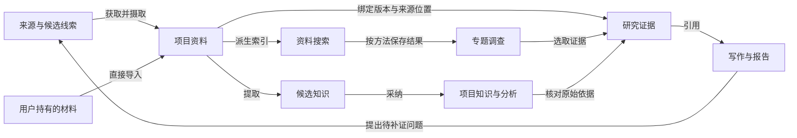

# MRW 总体设计

MRW 是本机单用户的项目化研究工作台。它把研究问题、外部来源和用户已有材料组织成可搜索的资料、可复核的证据、可编辑的研究成果。研究可以从发现新来源开始，也可以从导入材料、检索已有资料或补查已有报告开始。下面说明这些路径为何能交接、谁拥有事实，以及哪些图形或目录只是观察入口。安装和日常操作见[使用说明](../usage.md)。

## 能力范围

下表是当前产品的完整能力边界。它描述仓库里已有的领域入口及其关系，不表示每个外部通道、项目方法或部署环境都已在本机验证可用；具体前提和限制应在对应专题、配置与运行状态中核对。

| 能力域 | 当前形态 | 入口 |
| --- | --- | --- |
| 项目空间与研究口径 | 项目隔离资料、配置、成果和运行记录；窗口选择不替代授权。 | [项目服务](../../main/backend/app/services/projects)、[项目 API](../../main/backend/app/api/projects.py) |
| 来源发现与来源资产 | 来源项、通道、候选地址与搜索策略分开维护，发现结果不是已入库材料。 | [来源库定义](../../main/backend/docs/RESOURCE_LIBRARY_DEFINITION.md)、[来源库服务](../../main/backend/app/services/source_library) |
| 多来源采集与材料接入 | 直接导入、URL 与来源通道共用既有摄取边界，各入口保留自己的后处理。 | [摄取架构](../../main/backend/docs/INGEST_ARCHITECTURE.md)、[摄取服务](../../main/backend/app/services/ingest) |
| 资料整理与质量控制 | 解析、去重、质量判断和材料持久化是不同步骤，不以索引记录代替原文。 | [摄取架构](../../main/backend/docs/INGEST_ARCHITECTURE.md)、[材料合同](../../main/backend/app/contracts/materials.py) |
| 项目资料库与检索 | 普通检索按当前项目返回材料观察；索引是派生结构，可按原文重建。 | [检索设计](../../main/backend/docs/INFORMATION_RETRIEVAL_FRAMEWORK_DESIGN.md)、[搜索 API](../../main/backend/app/api/search.py) |
| 专题调查与迭代检索 | 有项目方法、计划、运行、证据和读回；普通搜索命中不是完整调查结论。 | [专题检索服务](../../main/backend/app/services/project_retrieval) |
| 内容理解与结构化提取 | 从材料产生候选对象、关系和主题，不因提取动作自动变成正式知识。 | [摄取服务](../../main/backend/app/services/ingest)、[图谱服务](../../main/backend/app/services/graph) |
| 知识组织与关系探索 | 类型化知识、信息拓扑、领域图谱和线索链各自保存不同结构，不合并为一张通用图。 | [类型化知识](../../main/backend/app/services/typed_knowledge)、[信息拓扑](../../main/backend/app/services/information_topology) |
| 专题分析与数据展示 | 图、政策、看板和管理页是已有结构的观察入口，不替代领域写入。 | [前端页面](../../main/frontend-modern/src/pages)、[分析接口](../../main/backend/app/api) |
| 证据与引用管理 | 证据绑定原材料、实际版本和位置；新版出现不自动改写已有引用。 | [写作服务](../../main/backend/app/services/writing)、[材料实体](../../main/backend/app/models/entities.py) |
| 研究写作与报告交付 | 文档正文与引用归写作服务；报告负责补源、生成、质量检查与导出，草稿和正式交付门槛不同。 | [写作 API](../../main/backend/app/api/writing.py)、[报告 API](../../main/backend/app/api/llm_report.py) |
| 智能助手与流程协同 | 嵌入 Agent 通过 Cell 获得项目、会话、工具和批准绑定；已定义流程可运行，任意画出的图不自动可执行。 | [Agent 架构](../../main/backend/docs/AGENT_MACRO_ARCHITECTURE.md)、[工作流服务](../../main/backend/app/services/workflow_graph) |
| 任务管理与业务治理 | 任务、队列、失败回读、审批和运行观察由各自领域服务持有，不以界面状态代替领域事实。 | [任务 API](../../main/backend/app/api/process.py)、[运行服务](../../main/backend/app/services/agent_sessions) |

这张图描述资料如何交接，不是可执行的工作流图。每个项目有自己的研究范围、配置、成果和运行记录；图中的操作并不要求一次性从头到尾运行。嵌入 Agent 可以在多个位置协助，但不替代这些领域操作。

## 项目、来源与材料

**项目规定研究作用域，不是导航状态。** [项目 API](../../main/backend/app/api/projects.py)与[项目服务](../../main/backend/app/services/projects)处理项目标识、生命周期与数据隔离；项目适配和配置可以选择来源、专题方法或模板，并不授予访问权限。设计要求是窗口或会话独立选项目，在途工作持有发起时的项目；归档停止新写入和执行，已有成果能读取、追溯和导出。当前实现的窗口独立性与各写面归档限制不能只凭某个界面或项目路由判断。

**来源项、采集通道、候选地址和入库材料不是同一种事实。** [来源库](../../main/backend/docs/RESOURCE_LIBRARY_DEFINITION.md)记录从哪里找和可用什么通道。发现结果可能只是一条待获取的线索；网络响应也未必已通过解析、去重、质量检查并持久化。直接 URL 与来源 URL 入口准备各自的 `FrontDoorExecutionProtocol`，复用 [`fetch_routed_targets`](../../main/backend/app/services/source_library/orchestrators/url_execution.py) 的路由、抓取和回退，实际写入仍由各入口的原后处理负责。站内搜索复用统一搜索和 [`fold_search_observations`](../../main/backend/app/services/source_library/orchestrators/site_search.py)；显式获取与按通道处理候选池的后续效果各自保留。来源分类的设计以确定性规则为主，Agent 可经 Cell 给出建议；明确采纳后才由原领域操作改分类。

**原文与项目收录分别决定什么能共享。** 现行规范实体是 [`Material` / `materials`](../../main/backend/app/models/entities.py)，不是界面的资料卡或索引记录；项目库管理自己的资料和成果。设计上同一原文可被不同项目显式收录，收录、标注、可搜范围和研究成果仍各属项目；这不等于现行存储已完成跨项目版本共享。普通批量导入以每条材料的提交和读回为准：一条失败不应抹掉其他成功项。解析、去重和已有摄取边界见[摄取设计](../../main/backend/docs/INGEST_ARCHITECTURE.md)与[摄取服务](../../main/backend/app/services/ingest)。

## 资料搜索、专题调查与知识组织

普通资料搜索按当前项目查询并返回材料观察；[专题检索](../../main/backend/app/services/project_retrieval)另有项目方法、计划、运行标识、证据与读回。两者可以复用检索设施，普通命中不因此成为完整调查结论。[检索设计](../../main/backend/docs/INFORMATION_RETRIEVAL_FRAMEWORK_DESIGN.md)说明方法路径与资料结构如何关联，不把某个项目的方法当成所有项目的默认行为。

**索引可重建，原文不可由索引反推。** [索引服务](../../main/backend/app/services/indexer)持有派生索引，不是材料 writer。设计要求资料库能显示已保存的新版本；新索引未就绪时，仍可检索旧索引，命中必须标出实际版本。检索通道不可用不等于没有命中：成功通道可返回，结果应标明不完整；专题方法缺少必要通道时不能把运行算作完整。这些是对读回语义的要求，不表示全部搜索通道已提供相同保障。

**提取结果不是采纳结果。** [类型化知识](../../main/backend/app/services/typed_knowledge)定义知识条目、类型关系、主题组织及面向写作的交接。规则明确时可以自动采纳；仍需要保留来源、所用规则与撤回边界。单次抽取或图谱出现节点不能充当采纳事实。领域图谱、政策或其他专题展示根据其来源和合适的分析口径组织观察，不能通过图形编辑或聚合替代原领域写入。实现入口见[领域图谱](../../main/backend/app/services/graph)和[政策分析界面](../../main/frontend-modern/src/pages/PolicyPage.tsx)。

## 信息拓扑、版本引用与视图

信息拓扑是有限、有类型的信息关联结构。稳定身份 `ElementRef` 由项目、模块、命名空间、类型和局部 ID 组成；`BoundRef` 另含观察修订，可带内容摘要。标题相同不是同一元素。引用已有版本时，不得用当前版本伪装旧版本；找不到被引用版本应报告不能解析或已过期。内容摘要只能帮助确认读取对象，不能凭自身补回丢失内容。

- **用各自的 profile 规定合法结构。** 类型、端点角色、基数、次序和局部约束随领域而定。关系本身也是元素，可以有多端点、同目标的不同角色或指向另一关系；报告大纲要求单根有序树，其他信息关联并不都受树或 DAG 约束。
- **视图与映射只有派生权限。** 视图以 profile 定义及输入修订为依据，保存必要的成员身份和关联；展示时可折叠或省略结构，不能因此宣称无损。若要比较映射，分别说明覆盖范围（完全或部分）和保真（无损、有损或未核验）；只有相对于明确观察有见证，才可以称为无损。图视图不是原事实的第二个 writer。
- **拓扑只能写其拥有的结构事实。** 修订表保存历史、当前版本唯一，删除以 tombstone 保留身份。批量修改依据基础版本和约束读集，在同一事务检查并提交。材料、写作正文、已采纳知识、领域图谱与线索状态仍走其原领域服务。

| 容易混淆的结构 | 要读的事实 |
| --- | --- |
| [信息拓扑](../../main/backend/app/services/information_topology) | 跨模块表达与关联；[HTTP 入口](../../main/backend/app/api/information_topology.py)处理读取、关系和结构写入。 |
| [领域图谱](../../main/backend/app/services/graph)与[图页投影](../../main/frontend-modern/src/pages/graph/realizer/topologyProjection.ts) | 前者含领域节点和边；后者取已有结构显示，可能压缩多元关系，不是新的领域图。 |
| [工作流图](../../main/backend/app/services/workflow_graph) | 运行定义、执行依赖、参数和结果；语义关系不自动成为可执行依赖。 |
| [线索链](../../main/backend/app/services/clue_chains) | 记录调查线索、逐步推进、证据与取舍；不是通用信息关系存储。 |

现有拓扑已接入材料和专题检索；写作面板把大纲结构与正文分开。不能假定所有原生对象都能按历史版本解析，也不能从有映射 API 推断已有可运行映射。[专题检索中的拓扑装配](../../main/backend/app/services/project_retrieval/topology.py)是判断现役映射与 resolver 的入口；[图页](../../main/frontend-modern/src/pages/GraphPage.tsx)的界面投影不替代服务端事实。

## 证据、写作与报告

证据能回到原材料、实际使用的版本和位置；引用卡把它交给写作，不会因为材料库出现新版本而自动改证据。正文、文档版本和引用编辑归[写作服务](../../main/backend/app/services/writing)，围绕大纲的结构事实归信息拓扑。[报告接口](../../main/backend/app/api/llm_report.py)还负责来源补充、报告生成、质量观察和导出。允许先写证据不足的草稿，正式交付需满足模板证据要求；无匹配与取源故障必须分别说明，不能用空来源冒充取源成功。版本引用的完整读回与报告证据要求须按实际消费者核验。

Agent 编辑工具把宿主调用翻译为 [`EditDocumentCommand`](../../main/backend/app/services/writing/document_edit.py)，以同一组正文操作和幂等判断调用原文档 writer，工具端只压缩返回。URL 读回工具在宿主获准后调用 [`read_url_pool_evidence`](../../main/backend/app/composition/url_pool_readback.py)，核对精确版本、运行身份和材料来源；会话工具记录或可见输出不取代领域读回。

## Agent、执行与故障边界

**嵌入 Agent 是核心入口。** [宿主页面](../../main/frontend-modern/src/pages/CodexAgentPage.tsx)、Codex WebUI、Codex Core 与 [Cell](../../main/backend/docs/AGENT_MACRO_ARCHITECTURE.md)作用不同：WebUI 负责交互，Core 进行模型判断和循环，Cell 将项目、会话、工具、参数及批准绑定到系统操作，原领域执行单元仍拥有写入和副作用。上传附件不等于材料入库；纯附件回合的设计需要保留附件身份、所属项目和可靠输入回执。能力投影、目录可见、完成绑定、获准执行和结果读回是不同事实；无绑定、无授权或未挂载应报原错误，不能静默绕过 Cell。

**定好的流程可以运行，不等于任意画出的图可以执行。** [工作流服务](../../main/backend/app/services/workflow_graph)保有编译、定义、运行与交接，业务入口根据各自前提进入既有队列或执行单元。耐久运行的 [`PostgresTerminalCommitHook`](../../main/backend/app/successor_runtime/substrate/postgres/terminal_commit.py)在同一连接内提交终态、后继及父任务收束；领取任务时的执行资格沿显式策略核对。事件 [`replay_runtime_events`](../../main/backend/app/successor_runtime/runtime/replay.py)按受支持规则重放观察，不控制 Runtime；[任务接口](../../main/backend/app/api/process.py)向界面提供观察与操作入口。只读或已知幂等操作可以按合同重试；副作用未知时先读回，不能确认则停止而非自动重放。

## 内部装配、客户端与本机运行

设计按局部整体（Local）刻画职责与依赖；模块是具有明确职责、贡献和消费合同的一类 Local，而抽象工具层、Cell 或其部分不必都变成模块。模块职责、交付制品、项目选择是不同关系。现役内部装配通过[原生贡献目录](../../contributions/project_catalog.py)与[后端装配](../../main/backend/app/composition)形成实际接线，目录和视图沿原定义派生；定义或目录项本身不授予执行。当前范围不包括用户安装、启停或恢复外部模块，也不需要以统一层级重包所有原生调用。

前端的[模块入口与路由](../../main/frontend-modern/src/app/kernel)组织研究工作台、分析/可视化和管理界面；跨项目、跨服务的权限仍由对应操作核验。[后端接口文档](../../main/backend/docs/README.md)定位路由、接口和专题。主数据库是必须的启动依赖，其他依赖按能力影响故障范围，备份需覆盖项目、材料、引用、成果与所支持的记录；索引可重建、凭据重新配置，恢复记录不等于恢复在途执行。[运维说明](../../main/ops/README.md)维护运行与故障处置。容器自托管和非本机多人访问不是当前的正式支持范围。
