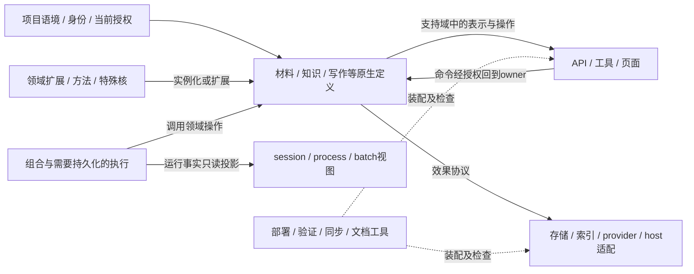

# MRW 精简框架

> 2026-10-07 · 全平台总设计已完成主线审查。本文维护平台目的、能力与事实归属、精简方向及成本基线；首阶段分派与验收合同单独见[平台结构精简与删减阶段](MRW平台结构精简与删减阶段.md)，首阶段已完成本地验收，状态为`LOCAL_COMPLETE_NOT_RELEASE_AUTHORITY`；最终集合、执行归属、成本及限制见阶段文件§8。本地统一提交随本批次收口；未push或deploy，不建立发布权限。

## 1. 平台目的与设计范围

[项目 README](../../README.md)将 MRW 定义为“面向研究与信息处理的通用平台”。用户在项目语境中组织来源和材料，选择研究方法，取得并检索信息，建立知识与关系，形成可追溯的分析和写作结果；原生 Agent、业务界面和 API 是这些能力的入口。通用性来自共享对象、可组合操作和可扩展的领域解释，不取决于每个操作是否进入同一运行系统。

本次精简覆盖完整平台：项目与身份、来源与材料、检索与索引、信息拓扑和知识、分析与引用写作、领域扩展、工具与工作流、前后端表示、原生宿主接入、部署、验证和开发文档。共同问题是同一事实在多处维护、同一控制义务多头承担、规则确定的接线仍由作者重复编写，以及当前入口与历史承载混杂。已有正确收敛直接保留，真实领域差异和独立生命周期继续存在。

目标是降低**完成或扩展一项用户能力所需的维护半径、独立事实副本和总维护成本**。源码净减是必要结果之一，不能代替能力、类型、权限与失败保持。运行时是一个跨领域支撑面；其约14万行规模和旧服务执行重叠值得处理，但不能决定整个平台的组织及所有工作的前置次序。

整体实现的首个大阶段是“平台结构精简与删减”，目标结构、删除族、范围、分派与退出条件见[独立阶段文件](MRW平台结构精简与删减阶段.md)；后续事项不占本阶段完成条件。

### 1.1 本轮依据与边界

源码基线为 `main@23468a40f4b2ad0b6055cdf089601668d58d6d52`；观察含共享工作树中的 tracked/untracked 文件，本文本身仍为 untracked。当前入口包括业务前端5173、Codex WebUI8172及API8000/docs；这些是文档配置，未在本轮启动或验证服务。静态挂载、源码可达、测试引用与真实业务运行分别记录，不能互换。

前一轮服务/运行时调查继续用于[首阶段执行合同](MRW平台结构精简与删减阶段.md)。全局补充调查覆盖领域/扩展、API/UI/宿主、部署/验证/文档。最初三名GLM Flash只读者因429未产出；主线改用三名DeepSeek Flash只读者并复核争议点。没有据模型分派或静态阅读宣称全平台运行验收。

实施仍受[19号流程缩减规则](../../development/latest-dev-docs/development-plans/CURRENT_DEV/2026-09-04-formal-production-release/19_direct-testing-batch-freeze-amendment.v1.md)与[06号当前入口](../../development/latest-dev-docs/development-plans/CURRENT_DEV/2026-09-04-formal-production-release/06_production-deployment-stage-progress.v1.md)约束。本轮不恢复旧任务；当前执行按[阶段文件](MRW平台结构精简与删减阶段.md)的责任包重新发放，直接修复、最小相关验证、稳定后按真实交付需要统一封存。

## 2. 能力、事实与消费者

### 2.1 能力地图

下表记录已知消费者族及其权威位置。一个能力可以由互相关联的原生定义组成：实体schema、操作签名、权限和特定UI表达承担不同事实。无需新增万能`CapabilitySpec`或主配置把这些定义重新抄录。表中路径相对仓库；`A=main/backend/app`，`F=main/frontend-modern/src`。

| 用户能力 | 权威定义与领域写入责任 | 已知消费者族 | 当前承载与扩展方向 |
| --- | --- | --- | --- |
| 建立项目、选择领域与约束 | `A/models/entities.py`项目实体、项目服务；可信身份及原grant/approval定义；customization与extraction各自协议 | projects/admin API、项目选择、工具context、检索绑定、采集与写作 | `A/project_customization`、`A/subprojects`及项目配置；共享身份装配，领域协议分别扩展 |
| 组织来源、资源与候选 | resource/site-entry等实体、`services/resource_pool/site_entries.py`；source/channel与候选typed contracts | resource_pool/source_library/discovery API、资源界面、搜索与采集工具 | 来源发现、URL资源、项目/共享资源有不同身份和可见性；适配器承担外部协议 |
| 导入、取得和管理材料 | `models/entities.py::Material`及领域writer族；`Document`为同一映射的兼容别名；原导入/抽取核 | ingest/crawler API与任务、document queries/views、搜索、拓扑、写作引用、原生工具 | `services/ingest`与领域数据接口；provider和项目抽取adapter可替换，正文权威不转移到图节点 |
| 检索、索引和迭代调查 | `services/search`候选/查询合同、现行index服务与ES协议、`services/project_retrieval`方法/预算/结果 | search/indexer/project_retrieval API、检索工具、图谱和资源搜索、写作suggest | 搜索索引是派生表示；研究方法决定问题/后续判断，执行层承担需要持久化的生命周期 |
| 表达知识、关系与信息结构 | `services/information_topology/{contracts,structural_schema,repository,service}.py`、typed知识原贡献与writer、图节点/边实体 | information_topology/typed_knowledge API、Graph、检索IO、写作context | 信息结构包含对象/关系/出现位置；方法结构和运行状态分别关联，不压成一张无类型图 |
| 分析、报告与引用写作 | `models/writing_entities.py`的WritingDocument/Draft/Citation；`services/writing`文档/引用/模板等事务；报告和LLM动作各自合同 | writing/reports/llm_report API、WritingWorkbench、拓扑写作context、工具 | 材料引用保留来源身份；正文版本/ETag、草稿、引用更新各有生命周期；LLM/provider是效果边界 |
| 调用工具、构造和观察工作 | `agent_core/contracts.py::CoreToolSpec`、原native贡献、工作流模板/版本、原组合语言；运行事实owner | 原生Core、functorial/workflow_graph/agent_batch API、session/process、WorkflowDesigner | direct/sync/durable按合同选择；宿主推理和MRW领域/运行权限分属各自owner |
| 访问、管理和部署平台 | API显式mount与权限依赖；`F/app/kernel/moduleManifest.ts`及页面表达；部署脚本/依赖清单 | HTTP客户端、业务前端、CodexAgentPage、WebUI、CLI/CI和开发者 | frontend已有manifest派生routes/registry；WebUI为上游vendor＋MRW边界适配；运行模式和验证工具属于交付责任 |

API挂载见`A/api/__init__.py`，包括上述领域、配置/治理、skills、agent_cell、clue_chains等。挂载证明入口存在；provider是否可用、各分析/报告链是否完成真实读回，仍由对应能力owner验证。历史[能力清单](../architecture/MRW项目能力清单_替代方案评估.md)用于识别覆盖面，其历史实施描述不代替当前源码证据。

### 2.2 五种职责如何组成同一平台

| 语义职责 | 拥有的事实与义务 | 实现选择 |
| --- | --- | --- |
| 共同核心 | 项目语境与身份、跨能力引用、公共材料模型、typed组合及必要运行/权限规则 | 在现有实体、贡献、组合与运行模块收敛；只提取已确认共有语义 |
| 领域扩展 | 方法、词表、抽取规则、channel特殊核、分析判断、模板、领域预算及特殊见证 | 复用customization、extraction adapter和原typed贡献；不可推导语义由作者给出 |
| 应用入口 | API envelope、工具调用协议、页面交互/布局、宿主context接入 | 支持范围中的操作/表示；确定性注册与投影可派生，独立权限/生命周期/交互保留 |
| 效果适配 | DB事务、索引、网络/provider、broker与原生host协议、真实结果读回 | 复用现有adapter/writer；协议内重试与业务运行重试分别负责 |
| 交付工具 | 环境装配、运行模式、测试选择/资源、派生同步、文档导航和历史恢复 | 复用现有scripts、kit gates、CI与运维入口；以可复核依赖决定收缩 |

MRW必须自己拥有项目与领域对象的含义、跨能力身份/引用、权限判定责任、方法与结果的合法性，以及对用户承诺的生命周期。宿主推理、数据库、索引、效果协议、UI和部署承载可以替换；替换要保留上述观察合同。当前实现是取证和复用起点，不因存在就获得长期保留结论；本轮只划定替代性边界，不做产品选型或引入依赖。

这五种职责允许在同一模块中共同实现，不要求新增五层、五目录或五服务。模块拆分须由真实生命周期、权限、资源或替换需求支持。现有`services`可以承载领域核、事务和请求适配；其中重复的通用执行责任才迁移和删除。

投影可多份，事实写权按事实唯一归属；“唯一”不是全平台只有一个writer函数。Material由其领域writer族维护，写作文档由写作事务维护，运行事件由运行owner维护。索引、页面、session/process不能通过读操作创造这些源事实；编辑命令回到owner。

### 2.3 三种结构及形式构造

**研究方法结构**表达目标、材料要求、选择规则、论证与下一步判断；**信息结构**表达材料、知识、关系和引用；**运行过程结构**表达操作出现、数据依赖、效果、等待和恢复。方法可以生成运行描述，运行可以取得或修改信息结构，信息观察可以影响方法判断。对应的类型和身份显式保留；Graph页面也可以显示不同视图，而页面布局矩阵另属UI结构。

对一个项目语境，领域对象与合法typed操作形成候选结构，操作包含失败及权限前提。项目扩展通过原协议实例化或精化局部结构，入口只解释其支持的部分，执行也只解释具有对应生命周期的部分：

$$
\mathcal D_p\quad\xleftarrow{\;\text{实例化/精化}\;}\quad\mathcal E_p,
\qquad R_s:\mathcal D_p|_s\longrightarrow\mathcal V_s,
\qquad F_e:\mathcal D_p|_e\longrightarrow\mathcal I_e.
$$

这里`R_s`可为HTTP、工具或页面的表示，`F_e`可为请求内调用或耐久执行。表示允许有方向的有损投影，例如UI摘要和搜索索引；反向更新必须是明确的领域命令。项目可见性可按索引语境组织为限制关系；当前grant撤销、预算和资源占用依赖执行时事实，不能由静态可见性推导。恒等、有序复合、字段/身份保持等主张必须有对应类型、测试或声明偏差，不因使用范畴语言自动获得自然性、交换或粘合定理。

## 3. 全平台选择与删减保持见证

| 组织候选 | 代价与决定 |
| --- | --- |
| 以现有successor或单一万能能力配置统一全部入口 | 把读取、写作、布局、领域扩展与运行协议绑在一起，增加语义重录和无必要持久化；不采用 |
| 按API/前端/services/项目目录分别减文件 | 容易保留跨目录事实副本与消费者漂移；只作为定位方式 |
| **围绕能力及事实owner收敛，同形部分由原规则派生，独立生命周期局部承载** | 采用；用完整用户链和真实扩展证明删减后的保持，只对已确认重复作必要共享修复 |
| 重换外部框架、部署模式或工作流产品 | 当前没有兼容/迁移/运维净收益证据；由具体责任包提出有界候选，不预设整体替换 |

### 3.1 普通材料到引用写作的保持见证

首例固定为现有普通材料导入→搜索/检索读取→信息拓扑引用→引用写作。这是跨面验证旅程，用户仍可独立导入、查询、编辑和写作，各能力不被强制编成唯一流水线。沿`api/ingest.py`与原导入writer取得Material身份，通过原search/document查询和`information_topology/document_materials.py`引用它，再经`writing/document_service.py`及`citation_service.py`形成写作正文/引用读回。索引可以尚未建成而材料已持久化；检索结果与引用必须说明是否来自原对象或派生索引，不能把索引ACK当可搜索结果。

该首例检查普通读写经过多少独立模型/字段翻译、身份是否重复映射、同一字段在哪些位置手写、页面是否消费同一结果、正文与引用更新是否保持版本/权限。已有Material/Document统一和document queries/views共核直接复用。只删除已证实同事实的重复存储/解析/投影；草稿、发布正文、引用和图谱出现位置继续分别拥有必要身份。现有统一已成立的部分只作保持见证，不再建设一遍。此包可以先于任何动态运行首例完成。

### 3.2 非默认领域扩展的保持见证

固定使用现有`demo_proj`，与默认`business_survey`对照。`subprojects/demo_proj`实际声明ExtractionAdapter、Customization及`embodied`前缀；`project_customization/projects/demo_proj/__init__.py`跨树re-export该Customization。核对同一项目身份如何到达抽取、字段/LLM/工作流映射、资源处理及受支持页面/工具，不创建只为证明框架的新项目。

两个registry当前都有exact/prefix发现，但customization按前缀长度降序，subprojects按字典遍历；不能直接合并而改变匹配含义。候选是共享项目身份和发现装配，保持Customization与ExtractionAdapter两种协议。`hk_water_macro_registration_trial_20260928/customization.py`与hk水务版本相同且硬编码hk项目键，service以类键注册，构成静态身份漂移；实际被哪一live实例使用未核验。修复必须证明键、选择顺序及历史alias兼容。共享不可变项目配方可以参数化，每个实例仍保留自己的ProjectKey/scope；trial不能借hk身份混库。重复注册键必须拒绝或按明确合同覆盖，不能依扫描顺序暗覆盖。以上类和目录的存在是首例材料，尚未构成扩展行为已通过的见证。

扩展维护半径实际记录：领域定义/配置、项目身份注册、API/tool暴露、页面/翻译、typed wire映射、测试及部署分别修改多少处；每处是特殊语义还是可派生接线。没有当前证据的扩展面保留具名调查义务，不承诺自动生成所有入口。后端`get_menu_config`尚未找到前端caller，外部消费者未确认；据此不能删除菜单协议或强制前端改用它。

## 4. 横贯各能力的精简规则

| 轴 | 已有收敛与真实成本 | 目标、边界及责任 |
| --- | --- | --- |
| 数据与领域事务 | Material/Document同一映射；writing document/draft/citation、typed知识、拓扑有独立owner | 数据链包追踪一份源事实到查询/索引/图谱/引用；收敛机械映射，保留版本、ETag、来源和领域事务 |
| 类型与贡献装配 | CoreToolSpec/native规则及catalog已存在；公开DTO、wire、UI视图仍可能需不同表达 | 原生定义相互引用；已由规则确定的注册/校验/codec/投影工具派生。不得用Any抹身份、失败、budget；仅开放JSON/实际序列化边界加Schema |
| 方法、信息与执行 | 检索方法/拓扑与运行层部分交织；现有runtime可复用但尚非全平台最小答案 | 执行退役包只修当前删除族必要接缝并核算收支；保留direct/sync/durable、动态预算/取消等附录A合同，领域判断归领域owner |
| 前端与API | manifest→routes/registry/render绑定已经派生；另有KernelModuleKey union、placement、baselineInventory和i18n键 | 界面包复用manifest，核对页面身份与布局的共同字段；`interactionSurface`和`surfaceKind`保留不同含义。baseline库存被topology checker读取，先迁移checker观察后才可删除 |
| 工具与原生宿主 | CodexAgentPage承载iframe/project context；WebUI含上游代码、MRW patch与生成codex-schema | host拥有线程/模型循环，MRW拥有领域及工具授权；只收敛边界适配。vendor与generated不计自研冗余，不重写为MRW第二模型runtime |
| 权限、effects及运行投影 | API权限、宿主身份、grant、领域事务与运行journal是不同事实；部分session/task重复运行状态 | 每次效果按当前scope/grant验证；GET为观察，命令回owner；ACK、WAIT、UNKNOWN与业务完成分开。历史读取不能成为在线旧链fallback |
| 部署与运维 | launchd日常模式和隔离Compose模式有独立DB/资源身份；ops旧文档的kit路径与当前pin有漂移 | 交付包维护模式/环境/依赖契约，复用脚本；同project key不推断同DB。只删除真实过时启动/配置副本，不按运行方式数量机械统一 |
| 验证与开发流程 | CI和test-standardize含相同/近似marker选择；kit/dev.py承担结构gate；静态/UI/行为测试各有见证 | 验证包固定selector权威与差异，保留原七gate和独立见证；一次稳定输入执行必要集合，kept与本轮passed分开 |
| 文档与历史 | 当前入口、规则、能力说明和大量exact-byte冻结快照并存 | 当前事实各有入口；历史按checker/恢复依赖保留或迁移，不用新文档、证据或审批系统代替旧系统 |

typed知识的双实现是一个判断例：`services/typed_knowledge/persistence_boundary.py::persist_typed_knowledge_boundary`默认可用memory repository，但`build_live_db_boundary_envelope`显式注入SqlAlchemy仓储，live writing context强制`seed_sample=False`，sample helper使用memory。它们是否冗余取决于真实入口及样板用途，不能从两个实现推断两个生产writer；样板/seed实际可达性由数据包核验。

## 5. 全仓维护成本与净收益

### 5.1 分类账而非目录排行榜

本轮静态库存按`git ls-files --cached --others --exclude-standard`去重后统计存在文件，不进入ignored依赖目录。已核：app780文件（774个py）、backend tests637（627个py）、frontend-modern362、main/ops1236（其中WebUI src935、web227）、scripts134、根tests122、docs729、development9934。上述root按各自口径展示，子项不能再与父项相加。

`CURRENT_DEV`有9326文件，其中7576个无扩展名文件：7552个位于`/snapshots/`下的exact-byte快照，另24个为OCI布局、manifest等恢复文件；development逻辑文件大小合计378287390字节。统计为逻辑路径求和，不等于物理占用或可释放空间。当前checker与06入口仍引用快照；恢复和资格依赖尚未逐项迁移，故这些数值不表示可删数量。

| 成本分类 | 口径及当前证据 | 如何结算 |
| --- | --- | --- |
| 自有生产实现 | app、frontend src、项目kit桥、contributions；包含dirty新增 | 源码净变化、事实/执行owner数、真实扩展维护半径；外移仍算成本 |
| vendored上游及本地patch | `main/ops/codex-webui/README.md`记录上游commit和MRW patch | 上游体积与MRW维护补丁分别报告，升级/协议维护半径另计；不能整体称自研重复 |
| 生成协议/派生物 | WebUI codex-schema、原贡献registries/sketches等 | 生成来源、是否可重建、重复存储与构建成本单列；生成后同样有仓库成本 |
| 测试与fixture | backend/root/frontend测试，原七gate见证 | 独立行为/法则见证与同形fixture分开；删除镜像承载需保留原验证义务 |
| scripts/配置/交付 | 根scripts、backend脚本、CI、Compose/launchd及依赖pin | 同职责重复入口、selector/config漂移、维护文件数；不同资源模式不自动算重复 |
| 当前文档 | README、docs、当前执行合同/规则 | 当前事实入口数、失效链接与重复事实的更新面；不是单看字数 |
| 历史快照/恢复资料 | development中的exact-byte、旧候选与阶段记录 | 依赖解除后才能计算可移除量；归档搬移与实际删减分别记账 |

2026-10-07补充只读分账见`/tmp/mrw-structure-20261007-w4uct7gr/integration/nonproduction-cost-breakdown-1.json`（SHA256 `ca3dcef6080298e3521f5253d52a78ed9915c745b6a45a49e3ffcf690866cf1f`）。该快照按tracked/untracked去重、存在regular文件、排除已列runtime/build/sample路径，共14,836唯一路径；文件记录与各独占bucket的文件数、字节和LOC加总已核。LOC含空行/注释，二进制只计文件与字节。

| 位置分类 | 文件数 | LOC | 范围与限制 |
| --- | ---: | ---: | --- |
| vendor | 1,205 | 101,551 | WebUI纳管文件；不能全部算MRW手写补丁 |
| 非vendor生成物 | 6 | 3,533 | 原registries/sketches贡献派生物，具体路径见清单 |
| 配置 | 44 | 8,745 | 明列CI/Compose/依赖pin/环境模板等路径，不含vendor内配置重复求和 |
| docs与根入口位置bucket | 712 | 127,811 | **PARTIAL语义分类**：其中含541个ARCHIVE路径，不能视作纯当前维护面 |
| historical位置bucket | 10,433 | 7,944,469 | development/history/evidence/archive等路径；含现行引用，体积不等于可删量 |

生成物总维护范围为759文件／20,281行，其中vendor内753／16,748（Codex schema736／8,154，Web API17／8,594）；这是上述位置分类的重叠视图，不可再相加。exact-byte snapshots为7,574文件／4,005,962行，也不与historical重复求和。Codex schema来源为`@openai/codex@0.160.0`的`generate-ts`；Web API沿原`pnpm generate:api`和`openapi-ts.config.ts`，本次未重建。非vendor生成物由原贡献catalog与`functorial-kit.json`经`scripts/dev.py sync/check`派生；已有运行证据见阶段§8，本轮最终公共修改后的扫描另行记录，不把统计当生成验证。

pinned upstream `44ad73a99c4d4385fa60d0c519c243baf8f160b7`在本地Git缺blob，因而upstream→MRW patch changed-line delta仍**未知**。README的16 tracked＋8 allowlist仅为导入时24文件维护范围，具体原路径和patch行数不能由此推出。可核的当前dirty相对本地HEAD为15触及文件、全文件6,754行、增451／删103；whole-file范围与changed-line delta不同，不能相加或冒充上游补丁。原始current/history语义分界仍PARTIAL；本阶段有据保留恢复资料，不据这些量重开全树清理或网取上游。所有净收益继续将生产、测试、生成、文档和外移分账，未知不记0。

### 5.2 已测源码基线

2026-10-07 01:52:42本地只读快照；`git ls-tree -r 23468a40`的blob为基线，当前使用`git ls-files`加`--others --exclude-standard`，逐文件`splitlines()`。此次计数扩展集为`.py/.ts/.tsx/.js/.jsx/.css/.scss`，不含`.pyi`，含注释空行；与含`.pyi`的其他快照不直接相减；不含生成数据、Markdown、JSON、二进制和依赖目录。下面app/backend各行以Python为主；配置/生成物规模没有伪装成0。目录子项不能与父项相加。

| 范围 | HEAD行数 | 当前行数 | 净变化 | 当前untracked行数（已计入） |
| --- | ---: | ---: | ---: | ---: |
| backend app | 307501 | 313926 | +6425 | 2491 |
| 其中services | 130302 | 131866 | +1564 | 1182 |
| 其中successor_runtime | 135713 | 140829 | +5116 | 1309 |
| backend tests | 183409 | 187628 | +4219 | 3038 |
| frontend-modern/src | 70046 | 69923 | −123 | 0 |
| 根tests | 32406 | 32419 | +13 | 0 |
| src（项目kit桥等） | 4268 | 4268 | 0 | 0 |
| contributions | 38 | 38 | 0 | 0 |

对应当前目录：successor capabilities 54,455、substrate 49,523、runtime 16,010、language 7,797、assembly 7,326、specification 2,994、research 1,378、ops_domain 1,345。services中ingest 20,553、source_library 11,888、collect_runtime 2,490、agent_core 14,649、agent_runtime 5,889、agent_sessions 5,751、agent_batch 4,145、workflow_graph 5,280、projects 903、project_retrieval 4,337、search 3,825、resource_pool 8,420、llm 4,265；根模块及其余领域同样在总数内。剩余app约41,231行含API、models、composition/settings等，没有被排除于最终净变化。

### 5.3 按依赖和收益选择工作

优先度由当前确认的语义漂移/重复、完整消费者是否已找到、预计退出成本与新增共同规则成本、权限/数据迁移风险共同决定。无需把这些判断伪造成一个精确分数。最先可并行的是已有明确重复的数据表示、项目装配、页面身份副本、交付/验证副本，以及无接缝阻碍的旧执行块删除；执行族仅等待各自必要接口。

已知执行候选上界继续保留：first-specimen等样板族12229行、ingest验证脚手架3804行、URL相关候选1049行（其中已定位调度约593行）、resolver并发318行、C3四文件6123行。均含必要语义或验证用途，且可能重叠，不能相加当净删除承诺。动态运行改造的新增成本必须与该完整族退出成本一起计算，不能以未来未发放包承担其债务。

全局指标为：①同一事实独立维护位置数；②每条完整用户链的必要转换/装配次数；③真实非默认扩展的公共修改面；④独立通用执行/状态writer数；⑤自有生产、测试、生成与交付总量；⑥原行为及类型/权限/失败见证是否保持。原已测app307501、services130302、successor135713为代码基线；对已发放完整替换族要求净收缩，平台整体自有生产源码最终低于原基线总量。新的全平台设计不预设每个目录都必须独立变小，目录迁移不抵扣全仓新增；绝对删行目标须由实测退出量确定。

## 6. 首个大阶段：平台结构精简与删减

阶段目标、保留承载、删除族、防膨胀约束、工作包、串并行安排、验证资源及退出条件统一维护在[MRW 平台结构精简与删减阶段](MRW平台结构精简与删减阶段.md)。执行所需的严格合同、文件交接和历史证据也在该文件中。

首阶段已完成本地实施与原五项退出验收，状态为`LOCAL_COMPLETE_NOT_RELEASE_AUTHORITY`。最终原CI分组按真实执行与未变依赖复用闭合，原100/20覆盖率门禁通过；原失败attempt的exit1保留，不宣称新整套命令exit0。app307472（HEAD−29／dirty-start−6454），替换族161520（−550／−6688），tests186416单列；services及workflow/retrieval/shared增长责任继续保留。证据索引、4skip、内部类型债、浏览器mock与direct HOST范围、缺失调用/token成本统一见[阶段文件§8](MRW平台结构精简与删减阶段.md#8-当前执行状态2026-10-07)。本地统一提交随本批次收口；未push或deploy；后置类型治理、UI与性能不占本阶段完成条件。
